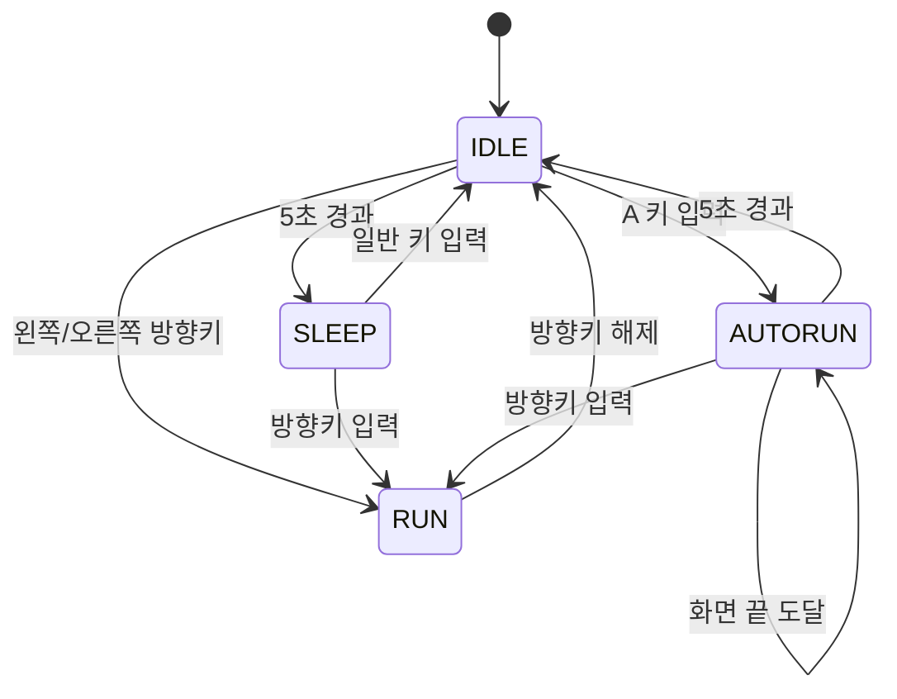

# Drill #11 - 소년 상태 머신과 AutoRun

## 1. 과제 개요

소년 캐릭터에 상태 머신 기반의 `IDLE`, `RUN`, `SLEEP`, `AUTORUN` 상태를 구현한다.
키보드 입력과 시간 경과에 따라 상태를 전환하고, 캐릭터의 이동·애니메이션·화면 경계를 처리한다.

## 2. 개발 목표

- 기존 `IDLE` 상태에 `SLEEP` 상태를 추가한다.
- 방향키를 이용한 일반 달리기(`RUN`)를 구현한다.
- `A` 키를 이용한 자동 무적 런(`AUTORUN`)을 구현한다.
- 모든 상태 전환을 `transitions.Machine`으로 관리한다.
- 시간 처리는 `pico2d.get_time()`을 사용한다.
- 캐릭터가 화면 밖으로 벗어나지 않도록 제한한다.

## 3. 상태 설계



### 상태별 역할

| 상태 | 역할 |
|---|---|
| `IDLE` | 제자리 애니메이션을 재생하며 5초 동안 입력이 없으면 `SLEEP`으로 전환 |
| `RUN` | 방향키 방향으로 일반 속도로 이동 |
| `SLEEP` | 캐릭터를 90도 회전해 잔디 위에 눕힘 |
| `AUTORUN` | 입력 없이 자동으로 이동하며 화면 양끝에서 방향을 전환 |

## 4. 기능 상세

### 4.1 IDLE

- 초기 상태는 `IDLE`이다.
- `IDLE`에서 프레임 애니메이션을 반복 재생한다.
- `pico2d.get_time()`으로 경과 시간을 측정한다.
- IDLE 진입 후 5초가 지나면 `SLEEP`으로 전환한다.
- 방향키를 누르면 해당 방향을 바라보며 `RUN`으로 전환한다.
- `A` 키를 누르면 `AUTORUN`으로 전환한다.

### 4.2 RUN

- 왼쪽 방향키를 누르면 왼쪽으로 이동한다.
- 오른쪽 방향키를 누르면 오른쪽으로 이동한다.
- 이동량은 프레임 수가 아니라 `delta_time`에 속도를 곱해 계산한다.
- 캐릭터 중심 x 좌표는 화면 안에서만 유지한다.
- 방향키를 놓으면 `IDLE`로 전환한다.
- 왼쪽과 오른쪽 키가 동시에 눌린 경우 마지막으로 눌린 방향을 우선한다.
- 마지막 입력 키를 놓아도 반대 방향키가 눌려 있으면 해당 방향으로 계속 이동한다.

### 4.3 SLEEP

- IDLE에서 5초가 지나면 진입한다.
- 캐릭터 이미지를 방향에 맞게 90도 회전해 눕힌다.
- 잔디 이미지의 상단 바로 위에 캐릭터가 위치하도록 y 좌표를 계산한다.
- 왼쪽 또는 오른쪽 방향키를 누르면 방향을 반영한 뒤 `RUN`으로 전환한다.
- 방향키 이외의 키를 누르면 `IDLE`로 전환한다.
- `IDLE`로 복귀하면 IDLE 타이머를 다시 시작한다.

### 4.4 AUTORUN

- `IDLE`에서 `A` 키를 누르면 진입한다.
- 일반 `RUN`보다 빠른 속도로 자동 이동한다.
- 자동 달리기 중에는 방향키 입력 없이도 계속 이동한다.
- 화면 오른쪽 끝에 도달하면 왼쪽으로 방향을 바꾼다.
- 화면 왼쪽 끝에 도달하면 오른쪽으로 방향을 바꾼다.
- 자동 달리기 시작 후 5초가 지나면 `IDLE`로 복귀한다.
- `AUTORUN` 중 방향키를 누르면 자동 달리기를 취소하고 일반 `RUN`으로 전환한다.
- `AUTORUN` 상태에서는 일반 RUN보다 큰 캐릭터 크기를 사용한다.

## 5. 입력 처리

| 입력 | 현재 상태 | 동작 |
|---|---|---|
| 왼쪽 방향키 누름 | `IDLE` | 왼쪽을 바라보며 `RUN` |
| 오른쪽 방향키 누름 | `IDLE` | 오른쪽을 바라보며 `RUN` |
| 방향키 해제 | `RUN` | `IDLE` |
| 방향키 누름 | `SLEEP` | 해당 방향으로 `RUN` |
| 일반 키 누름 | `SLEEP` | `IDLE` |
| `A` 키 누름 | `IDLE` | `AUTORUN` |
| 방향키 누름 | `AUTORUN` | 자동 달리기 취소 후 `RUN` |
| `ESC` 키 누름 | 모든 상태 | 프로그램 종료 |

## 6. 구현 구조

### 파일 구성

- `main.py`
  - 게임 루프
  - 이벤트 수집
  - 월드 업데이트와 렌더링
- `boy.py`
  - `Boy` 클래스
  - 상태 머신
  - 입력 처리
  - 이동 및 애니메이션
  - 상태별 출력
- `grass.py`
  - 잔디 오브젝트 출력
- `animation_sheet.png`
  - 캐릭터 애니메이션 스프라이트
- `grass.png`
  - 바닥 이미지

### 주요 구현 원칙

- 상태 전환은 `transitions.Machine`에서 관리한다.
- 시간 측정은 `pico2d.get_time()`을 사용한다.
- 이동은 `delta_time` 기반으로 처리한다.
- 방향은 `face_dir` 값으로 관리한다.
  - `1`: 오른쪽
  - `-1`: 왼쪽
- 동시 방향키 입력은 `pressed_directions` 집합으로 관리한다.

## 7. 검증 기준

- [ ] 프로그램 시작 시 `IDLE` 상태로 시작한다.
- [ ] IDLE에서 5초 후 `SLEEP`으로 전환된다.
- [ ] SLEEP 캐릭터가 잔디 바로 위에 눕는다.
- [ ] SLEEP 중 방향키 입력 시 즉시 `RUN`으로 전환된다.
- [ ] IDLE에서 방향키 입력 시 `RUN`으로 전환된다.
- [ ] 방향키를 놓으면 `IDLE`로 돌아온다.
- [ ] 좌우 방향키 동시 입력 시 마지막 입력 방향을 사용한다.
- [ ] 캐릭터가 화면 밖으로 이동하지 않는다.
- [ ] IDLE에서 `A` 입력 시 `AUTORUN`으로 전환된다.
- [ ] AUTORUN 중 캐릭터 속도와 크기가 증가한다.
- [ ] AUTORUN 중 화면 끝에서 자동으로 방향을 전환한다.
- [ ] AUTORUN 시작 후 5초가 지나면 `IDLE`로 돌아온다.
- [ ] AUTORUN 중 방향키 입력 시 일반 `RUN`으로 돌아온다.
- [ ] `py -3 -m py_compile boy.py main.py grass.py` 검사를 통과한다.

## 8. 실행 방법

`DRILL11` 디렉터리에서 다음 명령으로 실행한다.

```text
python main.py
```

실행 전 `pico2d`와 `transitions` 패키지가 설치되어 있어야 한다.

## 9. 커밋 규칙

- 커밋은 하나의 기술적 변경 단위로 작성한다.
- 서로 다른 기능을 하나의 커밋에 섞지 않는다.
- 커밋 메시지는 한국어로 작성한다.
- 커밋 메시지는 다음 형식을 사용한다.

```text
<단계>: <기술적 변경 내용>
```

- 기능 구현 전에는 PRD에 해당 단계의 목적과 완료 조건을 기록한다.
- 각 단계가 끝나면 관련 파일만 스테이징한다.
- 단계별 커밋 후 Python 문법 검사를 실행한다.
- 임시 파일, 캐시, 실행 결과물은 커밋하지 않는다.
- 기존 기능을 변경하는 경우 변경 이유와 영향 범위를 PRD에 기록한다.

## 10. 단계별 개발 계획

### 1단계: 기본 상태 머신 구성

- 대상 파일: `boy.py`
- `IDLE` 상태와 기본 애니메이션을 구성한다.
- 완료 조건: 프로그램 시작 시 `IDLE` 상태로 실행되고 캐릭터가 표시된다.

### 2단계: 일반 RUN 구현

- 대상 파일: `boy.py`, `main.py`
- 방향키 입력, 방향 전환, 키 해제, 화면 경계를 구현한다.
- 완료 조건: 방향키를 누르는 동안 이동하고 키를 놓으면 `IDLE`로 돌아온다.

### 3단계: SLEEP 구현

- 대상 파일: `boy.py`
- IDLE 5초 타이머, 눕기 출력, 키 입력에 따른 복귀를 구현한다.
- 완료 조건: 5초 후 SLEEP으로 전환되고 키 입력으로 `IDLE` 또는 `RUN`으로 복귀한다.

### 4단계: AUTORUN 구현

- 대상 파일: `boy.py`
- `A` 키 입력, 자동 이동, 속도·크기 증가, 화면 끝 방향 전환을 구현한다.
- 완료 조건: 5초 동안 자동 이동하고 방향키 입력 시 일반 `RUN`으로 전환한다.

### 5단계: 통합 검증

- 대상 파일: 전체 과제 파일
- 상태 전이와 입력 조합을 확인하고 문법 검사를 실행한다.
- 완료 조건: 상태별 검증 기준을 모두 만족하고 임시 파일이 없다.

### 6단계: 입력 이벤트 분리

- `KEYDOWN`과 `KEYUP` 처리를 분리한다.
- 눌린 방향키를 집합으로 관리한다.
- 완료 조건: 좌우 키 동시 입력과 해제 순서를 처리한다.

### 7단계: 시간 기반 갱신

- 프레임 간 경과 시간을 `pico2d.get_time()`으로 계산한다.
- 이동량과 상태 제한 시간을 프레임 독립적으로 처리한다.
- 완료 조건: 실행 속도와 관계없이 이동 및 5초 전이가 유지된다.

### 8단계: 화면 경계 처리

- 캐릭터 중심 좌표를 스프라이트 절반 크기 안으로 제한한다.
- 일반 RUN에서 좌우 화면 밖 이동을 차단한다.
- 완료 조건: 캐릭터의 이미지가 화면 밖으로 잘리지 않는다.

### 9단계: SLEEP 렌더링

- 현재 방향에 따라 스프라이트 회전 각도를 선택한다.
- 잔디의 상단과 캐릭터 높이를 기준으로 눕힌 위치를 계산한다.
- 완료 조건: 양쪽 방향에서 캐릭터가 땅 위에 자연스럽게 표시된다.

### 10단계: AUTORUN 이동

- `A` 입력으로 AUTORUN을 시작한다.
- 일반 RUN과 분리된 속도와 시작 시각을 사용한다.
- 완료 조건: 방향키 없이도 캐릭터가 자동으로 이동한다.

### 11단계: AUTORUN 방향 전환

- AUTORUN 중 화면 양끝에 도달하면 방향을 반전한다.
- 반전 시 캐릭터의 바라보는 방향도 갱신한다.
- 완료 조건: 자동 이동 중 화면 밖으로 나가지 않고 왕복한다.

### 12단계: AUTORUN 종료와 수동 전환

- AUTORUN 시작 후 5초가 지나면 IDLE로 복귀한다.
- AUTORUN 중 방향키를 누르면 일반 RUN으로 전환한다.
- 완료 조건: 자동 상태의 시간 제한과 수동 취소가 모두 동작한다.

## 11. 단계별 커밋 기록

| 단계 | 커밋 | 기술 내용 |
|---|---|---|
| 기반 | `0751cb3` | 상태 머신 기반 캐릭터와 AutoRun 과제 파일 구성 |
| 문서 | `0c8a5af` | 과제 요구사항과 구현 상세사항 작성 |
| 1단계 | `9e7bba0` | 한국어 커밋 규칙과 기술 변경 단위 정의 |
| 2단계 | `5b3779c` | 단계별 개발 순서와 완료 조건 정의 |
| 4단계 | `d0f0932` | 입력 이벤트 처리와 동시 입력 기준 정의 |
| 5단계 | `7227f28` | get_time 기반 시간 갱신 기준 정의 |
| 6단계 | `917e6a6` | 화면 경계 처리 기준 정의 |
| 7단계 | `a719a5a` | SLEEP 방향 회전과 위치 계산 기준 정의 |
| 8단계 | `a18d0ce` | AUTORUN 시작과 자동 이동 기준 정의 |
| 9단계 | `dc17450` | AUTORUN 화면 끝 방향 전환 기준 정의 |
| 10단계 | `7977501` | AUTORUN 종료와 일반 RUN 전환 기준 정의 |

### 최종 검증 명령

```text
py -3 -m py_compile boy.py main.py grass.py
```

### 커밋 제외 대상

- `__pycache__/`
- `*.pyc`
- IDE 임시 파일
- 실행 중 생성되는 로그와 캐시

## 12. Python 기능 커밋 기록

기능 구현은 다음 순서로 Python 파일을 단계적으로 추가했다.

| 단계 | 커밋 | 변경 파일 | 기술 내용 |
|---|---|---|---|
| 기반 | `635575f` | `boy.py`, `main.py`, `grass.py` | 기본 게임 객체와 게임 루프 구성 |
| 1 | `75ed6ec` | `boy.py` | IDLE 상태 머신과 애니메이션 추가 |
| 2 | `97ed09a` | `boy.py` | IDLE 5초 시간 제한과 SLEEP 전환 추가 |
| 3 | `70ceef2` | `boy.py` | SLEEP 키 입력 복귀 추가 |
| 4 | `a0bee40` | `boy.py` | 일반 RUN 이동과 방향키 전환 추가 |
| 5 | `3204594` | `boy.py` | 동시 입력 추적과 화면 경계 추가 |
| 6 | `71452d1` | `boy.py` | SLEEP 회전 출력 추가 |
| 7 | `96e02d3` | `boy.py` | SLEEP 방향키 RUN 전환 추가 |
| 8 | `f739173` | `boy.py` | AUTORUN 상태와 5초 제한 추가 |
| 9 | `b2af8b0` | `boy.py` | AUTORUN 화면 끝 방향 전환 추가 |
| 10 | `4403360` | `boy.py` | AUTORUN 방향키 취소 추가 |
| 11 | `519259b` | `boy.py` | AUTORUN 애니메이션과 확대 출력 추가 |
| 12 | `50e7d7a` | `boy.py` | 통합 입력과 SLEEP 위치 보정 |

각 기능 커밋은 독립적인 기술 변경 단위로 작성했으며, 최종 상태에서 다음 검증을 수행한다.

```text
py -3 -m py_compile boy.py main.py grass.py
```
